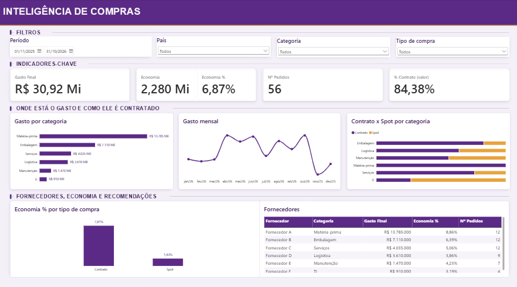

# COE Sourcing — Inteligência de Compras

Dashboard em **Power BI** que transforma uma base de pedidos de compras em informações visuais para apoiar a tomada de decisão da liderança de Suprimentos.




## Contexto

Uma equipe global de Suprimentos precisa acompanhar gastos, comparar categorias de compras, monitorar fornecedores e identificar oportunidades de melhoria. Em um cenário em que essas informações ficam distribuídas em uma planilha, a análise consolidada é difícil.

## Objetivo

- Identificar onde estão concentrados os gastos
- Acompanhar as economias registradas na base
- Avaliar a utilização de contratos
- Destacar categorias que merecem análise mais aprofundada

## O que o dashboard mostra

| Bloco | Conteúdo |
|---|---|
| **Filtros** | Período, país, categoria e tipo de compra |
| **Indicadores-chave** | Gasto final, economia (R$ e %), nº de pedidos e % de compras em contrato |
| **Onde está o gasto** | Gasto por categoria, gasto mensal e contrato x spot por categoria |
| **Fornecedores e economia** | Economia % por tipo de compra e tabela de fornecedores |

## Principais conclusões

Valores em reais, com câmbio fixo de referência de R$ 5,00 por US$ (a base original está em dólar).

- **Gasto total:** cerca de R$ 30,9 milhões em 56 pedidos (nov/2025 a out/2026).
- **Economia:** cerca de R$ 2,28 milhões (6,9%), calculada como valor de referência menos valor final.
- **Concentração:** Matéria-prima e Embalagem somam cerca de 68% do gasto.
- **Contrato rende mais:** economia de 7,8% nas compras em contrato contra 1,4% nas compras spot.
- **Oportunidade:** TI (apenas 25% dos pedidos em contrato), Manutenção e Logística concentram compras spot. Se o spot economizasse como o contrato, o ganho estimado seria de cerca de R$ 300 mil (cálculo ilustrativo).
- **Em andamento:** 2 pedidos, somando cerca de R$ 900 mil.

## Estrutura do repositório

```
├── README.md
├── Inteligencia_de_Compras.pbix     # relatório Power BI
├── Base_Ficticia.xlsx               # base fictícia de pedidos
└── dashboard.png                    # captura do dashboard
```

## Como abrir

1. Instale o [Power BI Desktop](https://powerbi.microsoft.com/desktop/) (gratuito, somente Windows).
2. Baixe o arquivo `Inteligencia_de_Compras.pbix`.
3. Abra no Power BI Desktop.
4. Se pedir para atualizar a fonte de dados, aponte para `Base_Ficticia.xlsx` em **Transformar dados → Configurações da fonte de dados**.

## Autor

**Luani Flores**
· luanisales@gmail.com
